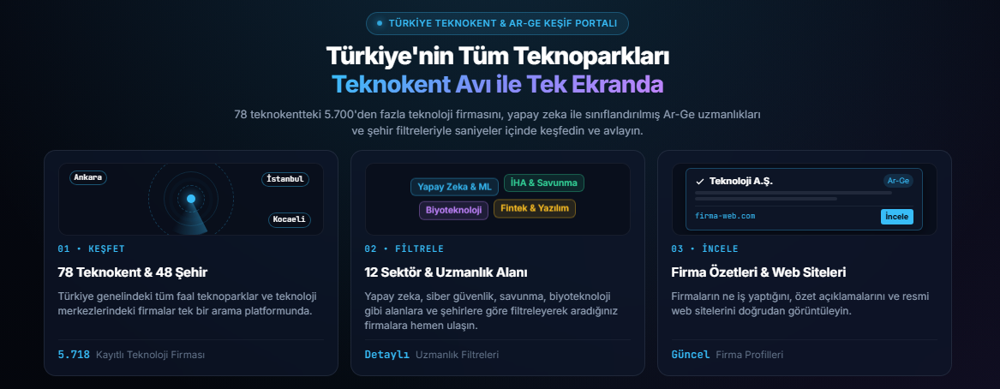

# Teknokent Avı

Türkiye genelindeki teknokent ve teknoparklarda faaliyet gösteren teknoloji ve Ar-Ge firmalarını tek çatı altında toplayan, tarayıcı üzerinde istemci taraflı çalışan arama ve keşif platformu.

## Kapsam

* 78 teknokent ve teknoloji geliştirme bölgesi
* 48 şehir
* 5.718 doğrulanmış ve aktif teknoloji firması
* 12 ana sektör ve 188 dikey uzmanlık alanı

## Mimari ve Çalışma Mantığı

1. **Veri Toplama:** Teknokentlerin firma dizinleri taranarak firma web sitelerine ulaşılmış, site içeriklerinden kurumsal faaliyet özetleri çıkarılmıştır.
2. **LLM ile Taksonomi ve Sınıflandırma:** Çıkarılan özet metinler, büyük dil modeli kullanılarak incelenmiştir. Firmalar faaliyet alanlarına göre 12 standart ana sektör ve ilgili alt uzmanlık kategorilerine etiketlenmiştir.
3. **Sunucusuz İstemci Mimarisi:** Platform, herhangi bir arka uç sunucusu veya API maliyeti olmadan çalışır. Veri seti istemci tarafına optimize edilmiş JSON formatında yüklenir ve tüm arama/filtreleme işlemleri doğrudan tarayıcı belleğinde gerçekleştirilir.

## Kullanılan Teknolojiler

### Yapay Zeka ve Sınıflandırma
* **Dil Modeli:** Qwen3-32B-AWQ
* **Hesaplama Ortamı:** Google Colab (GPU ortamı)

### Veri Tarama ve Bot Koruması Aşma (WAF Bypass)
* **Crawl4AI, Playwright, curl_cffi, BeautifulSoup4**
